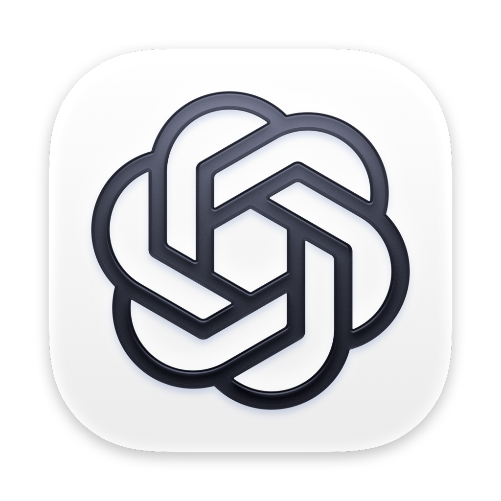

# Codex Weekly Usage - KDE Plasma Widget (Ubuntu 24.04 LTS)

A native KDE Plasma 5.27 widget to display your OpenAI Codex / ChatGPT weekly usage percentage remaining, countdown until reset, subscription tier, and available reset credits.

<p align="center">
  
</p>

## Features

- **Weekly % Remaining**: Automatically tracks your 7-day rolling quota (e.g. `56% left`).
- **Reset Countdown**: Shows humanized remaining time (e.g. `6d 11h 47m`) and local reset timestamp (`Sun, 11 Oct 12:34`).
- **Dynamic Color Indicator**:
  - 🟢 **Green**: Healthy quota (> 40% remaining)
  - 🟠 **Orange**: Moderate quota (15% - 40% remaining)
  - 🔴 **Red**: Low quota (< 15% remaining or warning threshold)
- **Dual Representation**:
  - **Panel / Taskbar**: Compact colored pill displaying `% left` with a rich hover tooltip.
  - **Desktop / Popup**: `[icon] Codex Usage` title, quota/time comparison card, and reset list. Click the Codex title icon (or focus it and press Space) to refresh manually; there is no separate refresh button. Status stays right-aligned in the fixed-height header through loading, failures, and recovery.
- **Low Footprint**: Driven directly by Plasma's event engine and Python 3 without running background Node or Electron daemons.
- **Offline & Cache Tolerant**: Saves snapshots to `~/.cache/codex_usage.json` for instant cold starts.
- **All resets visible**: Quota and time stay in place with “—” and empty gauges until data arrives. The popup grows to show every reset without scrolling; long labels and status summaries are elided instead of expanding the width.
- **Transparent retries**: The header identifies retained quota as saved and shows a short status or retry countdown. Hover or keyboard-focus the header status for the full saved date/time, error, and cooldown explanation. Server cooldowns disable manual refresh; ordinary retry backoff can be overridden manually.
- **Progressive recovery**: Temporary failures wait 15, 30, 60, 120, 300, then 600 seconds between attempts, measured from completion. HTTP 429 cooldowns are a minimum wait. Successful quota resets the schedule; credential and permanent failures retain normal polling.

---

## Requirements

- **OS**: Ubuntu 24.04 LTS with KDE Plasma 5.27+
- **Python**: Python 3.8+ (uses standard library only)
- **Codex / ChatGPT**: Authenticated session in `~/.codex/auth.json` (created automatically by `codex login` or the ChatGPT desktop app).

---

## Installation

1. In the repository directory, run:
```bash
./install.sh
```

This installs the widget into `~/.local/share/plasma/plasmoids/org.kde.plasma.codexusage` and registers it with KDE Plasma.

---

## How to Use

### Quick Preview
To test the widget right away in a floating test window:
```bash
plasmawindowed org.kde.plasma.codexusage
```

### Add to KDE Panel (Taskbar)
1. Right-click an empty area on your KDE Panel.
2. Select **Add Widgets...** (or press <kbd>Ctrl</kbd> + <kbd>F12</kbd>).
3. Search for **Codex Weekly Usage**.
4. Drag and drop it onto your panel.

### Add to Desktop
1. Right-click on your desktop wallpaper.
2. Select **Add Widgets...**.
3. Drag and drop **Codex Weekly Usage** onto your desktop.

---

## Configuration

Right-click the widget and select **Configure Codex Weekly Usage...** to customize:
- **Refresh Interval**: Default 10 minutes (`600s`).
- **Display Style**: Toggle between `% Remaining` and `% Used`.
- **Alert Threshold**: Define low quota warning percentage.

---

## Uninstallation

To remove the widget completely:
```bash
./uninstall.sh
```

Alternatively, you can remove it manually via:
```bash
kpackagetool5 --type Plasma/Applet --remove org.kde.plasma.codexusage
```

---

## Development Checks

These mocked checks need Python 3 and Node.js, but do not access live credentials or the API:

```bash
python3 -m unittest discover -s tests -v
node tests/test_scheduler.js
python3 -m py_compile contents/scripts/fetch_usage.py
```

The scheduler checks execute production QML functions/bindings, including synthetic backend payloads. They do not replace native Qt/Plasma rendering checks.

### Isolated Native Qt5 Validation (Docker)

To run the isolated native Qt5 and KF5 smoke checks in Docker:

```bash
bash tests/native/run.sh
```

Requires a working Docker daemon accessible to your user; no host Qt installation or sudo is needed. The Ubuntu 24.04 image installs Qt5 tools and KDE Frameworks/Plasma QML modules. Preflight executes `qmake`, `qmllint`, and `qmltestrunner`, verifying tool linkage, QML syntax, and layout bindings.

---

## License

This project is licensed under the [MIT License](LICENSE).
